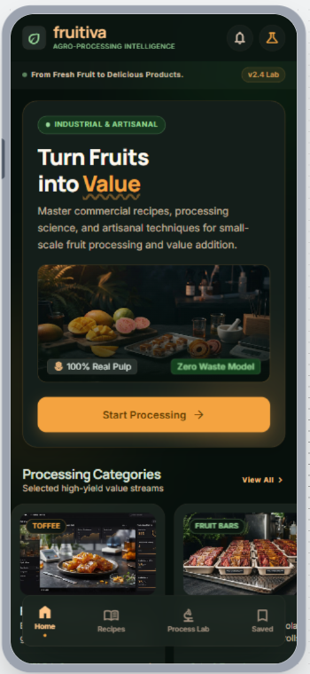

# FRUITIVA: From Fresh Fruit to Delicious Products

**A guide to the fruit-processing app: what it teaches, how to move through it, and how Google Stitch and Google Antigravity helped bring it to a phone.**

FRUITIVA is a learning app for people who want to turn fresh fruit into something they can wrap, pack, and share. It covers fruit toffee, fruit bars, and traditional sweets such as laddu and burfi. The writing stays practical and careful with measurements, so a home processor, a small food business, or an agricultural science student can follow a method with confidence.

The look of the app came first, on Google Stitch. The working phone app was then built with Google Antigravity. Those tools stayed in the background. What a person meets is a small, dark, warm kitchen of recipes.

*The FRUITIVA home screen: the promise, a way in, and the path to toffee, fruit bars, and saved recipes.*

## Who it is for

FRUITIVA speaks to learners who want the method, not only the dish. Each screen explains the product, lists what goes into it, and walks through the work in order: wash, pulp, cook, shape or dry, then pack.

The tone is clear and encouraging. Amounts, sheet thickness, and drying notes stay as they were supplied. Where a time or temperature was never given, the app says so.

## How the app is organized

The home screen opens with the line *Turn Fruits into Value*, under the promise *From Fresh Fruit to Delicious Products*. Three cards lead into the collection:

- **Fruit Toffees.** Six fruits: aonla, bael, guava, mango, banana, and papaya.
- **Fruit Bars.** Banana and mango sheets.
- **Traditional Sweets.** Aonla laddu and burfi, papaya burfi, and carrot burfi.

Below the cards, *Learn the Process* shows the same path every product follows: select and wash, peel and pulp, mix and cook, shape or dry, wrap and pack. A featured recipe invites the reader straight into mango toffee.

A bar along the bottom holds four places:

1. **Home**, the front door to every product.
2. **Recipes**, the toffee studio.
3. **Process Lab**, the fruit-bar kitchen.
4. **Saved**, the personal collection.

Traditional sweets open from the home card. The bottom bar stays on Home while that kitchen is open, so the four main places remain easy to see.

## Inside a recipe

Every recipe is built the same way, so the app feels familiar from the first fruit to the last.

A short introduction explains why the product matters. Pulpy-fruit sweets, for example, are presented as nutritious alternatives to ordinary sugar confectionery, with room for cottage and small-scale work.

Then the recipe itself:

- The fruit name and a photograph when one belongs to that product.
- Ingredients with amounts, such as pulp, sugar, glucose, milk powder, and butter or ghee.
- The method as numbered steps, from washing the fruit through wrapping and storage.
- A few process notes that matter on the bench: how far to concentrate the pulp, how thick to spread the sheet, how long to let it set, and, when the source gives them, the drying temperature and final moisture.

Mango toffee is the featured starting point. Switch fruits with the row of names across the top. Aonla, bael, guava, banana, and papaya each keep their own ingredients and steps. Bael toffee, for instance, is cooked to a firm consistency, spread thinly, and dried before it is packed. Banana toffee is pulped, sieved, cooked down, spread, and dried until the piece is ready to wrap.

The fruit-bar lab works as a comparison. Choose banana or mango. A simple line above the recipe shows the product moving from fresh fruit to pulp, to a spread sheet, to a dried sheet, to wrapped bars. The other fruit stays visible underneath, so both formulas can be glanced at together.

The sweets kitchen lists three recipes one after another: aonla laddu and burfi, papaya burfi, and carrot burfi. Each card carries its ingredients and the shaping step, whether that is rolling a laddu, cutting a burfi, or packing the pieces for use or sale.

## Saving a recipe for later

A heart on any toffee, fruit bar, or sweet keeps that recipe. The app confirms the choice with a short note, such as “Mango Toffee saved.” Tap the heart again and the recipe leaves the collection.

Saved recipes live on their own screen: *Your favorite fruit recipes, ready when you are.* They remain on the phone after the app is closed. If nothing has been saved yet, the screen says so and offers a way into the sweets kitchen, plus a path back to all six toffees.

## The feel of the screens

FRUITIVA is a dark green app with warm orange highlights, cream-colored writing, and photographs of the food itself: mango toffee, fruit bars on a tray, aonla sweets, papaya burfi, and carrot burfi. Cards are softly rounded. Headings are strong. Ingredient amounts stay large enough to read on a phone.

The same header appears everywhere: the word FRUITIVA and the line *From Fresh Fruit to Delicious Products*. Orange marks the button you are on, and the next step you can take.

## How Stitch and Antigravity were used

Google Stitch is a design canvas. For FRUITIVA it was used to picture the app before it was built. The brief was simple to say and specific to keep: a calm, appetizing classroom for fruit processing, with real recipes and the same navigation on every screen.

Stitch produced four phone screens: Home, the Toffee Recipe Studio, the Fruit Bar Processing Lab, and the Traditional Sweets Kitchen. Seeing them together made the product easy to judge. Did the home page explain the idea? Could someone move from a category into a full method? Did every screen still feel like FRUITIVA? Those questions were answered on the canvas, while changes were still easy.

Two lessons from that design work stayed with the app. Describe the mood and the job of each screen in plain language, so the screens belong together. Treat every measurement as part of the lesson. A nicer-looking number is the wrong number.

Google Antigravity is a development workspace where an agent can build the app from a clear brief. Here the brief was the screens already designed in Stitch, plus the real recipes. Antigravity turned that material into the Flutter app people install: the four-part navigation, the sweets kitchen opened from Home, and a Saved collection that stays on the phone.

The useful habit was supervision. The agent could assemble screens, connect the buttons, and store saved recipes. The recipe amounts, the order of the steps, and the path through the app still needed a human check. Open Home, open a toffee, switch fruits, save one, and find it again under Saved.

## What you can do with it

Open FRUITIVA when you want a guided path from fruit to product.

Start on Home and choose a family. Read the method all the way through. Compare banana and mango bars in the lab. Save the recipes you expect to cook. Come back to them from the heart tab.

The app is a small classroom: exact recipes, the same steps in the same order, and a place to keep the ones you want nearby.
